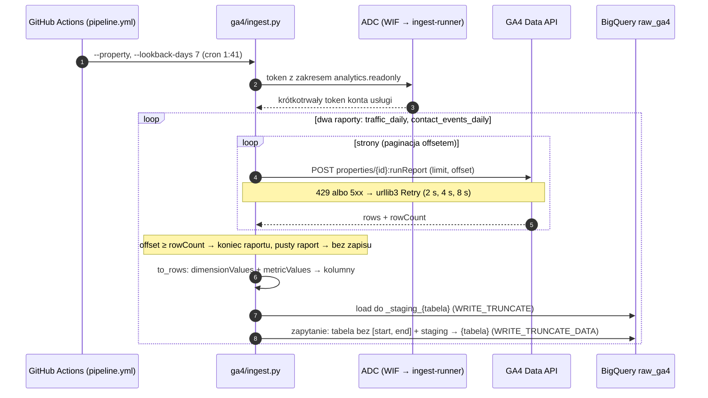

# Diagram sekwencji UML: jedno uruchomienie ingestu GA4

Kto wywołuje kogo w jednym przebiegu `ga4/ingest.py`. Wspólny zapis do BigQuery (staging → podmiana zakresu): [README główne](../README.md).

| Krok | Po co |
|---|---|
| 2–3 | bez klucza JSON: lokalnie impersonacja, w Actions Workload Identity Federation |
| 4–5 | `rowCount` mówi, ile wierszy ma cały raport — pętla wie, kiedy skończyć |
| 7–8 | podmiana zakresu jednym zapytaniem: powtórne uruchomienie nie dubluje wierszy |
