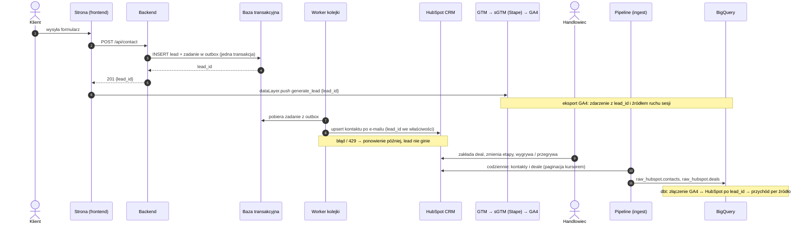

# Diagram sekwencji UML: formularz → HubSpot → BigQuery

Diagram sekwencji UML: jak lead i deal powstają w prawdziwej firmie i jak trafiają do hurtowni.
W tym repo kroki 1–9 udaje `generate.py`; kroki 10–11 to `ingest.py` — działa tak samo jak na produkcji.

| Krok | Kto pisze / obsługuje | Po co |
|---|---|---|
| 3 | backend developer | lead i zadanie dla HubSpota zapisują się razem albo wcale (wzorzec outbox) |
| 5–6 | backend + frontend | `lead_id` z bazy trafia do GA4 — jedyny wspólny klucz GA4 i CRM |
| 7–8 | backend developer (worker) | klient nie czeka na HubSpot, a jego awaria nie gubi leada |
| 9 | sprzedaż | etap deala zmienia się w czasie — dlatego ingest robi pełną migawkę |
| 10–11 | data engineer | ten sam wzorzec co `ingest.py` |
