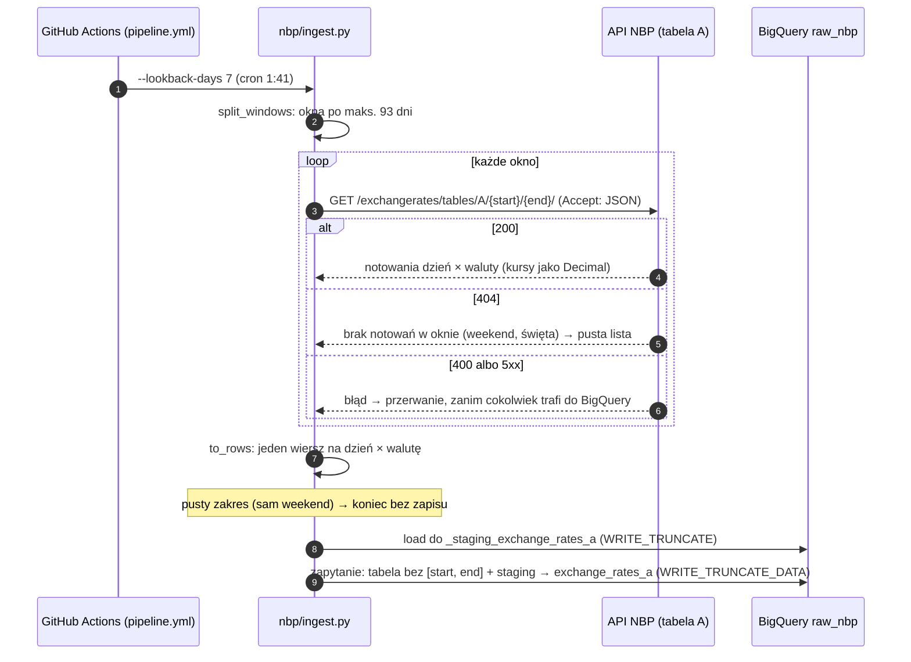

# Diagram sekwencji UML: jedno uruchomienie ingestu NBP

Kto wywołuje kogo w jednym przebiegu `nbp/ingest.py`. Wspólny zapis do BigQuery (staging → podmiana zakresu): [README główne](../README.md).

| Krok | Po co |
|---|---|
| 2 | API odrzuca zakres dłuższy niż 93 dni, a backfill obejmuje lata |
| 4–6 | 404 to poprawny stan danych, każdy inny błąd chroni tabelę przed dziurawym zakresem |
| 8–9 | podmiana zakresu jednym zapytaniem: powtórne uruchomienie nie dubluje wierszy |
