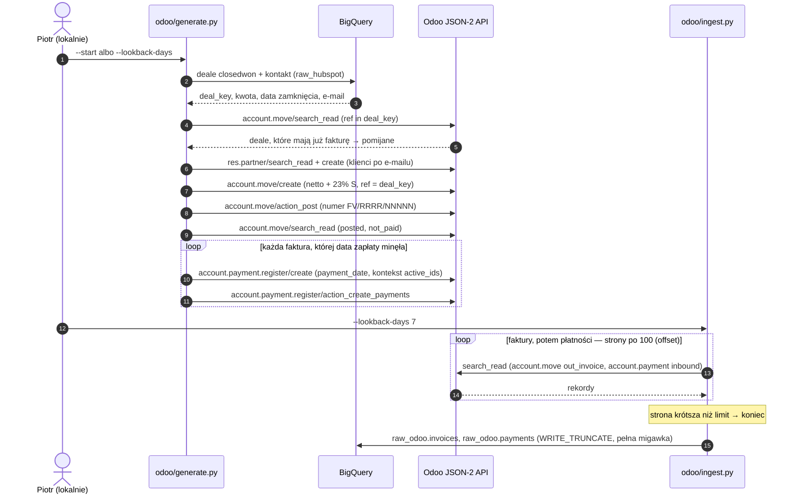

# Diagram sekwencji UML: wygrane deale → faktury → płatności → BigQuery

Kto wywołuje kogo w jednym przebiegu `odoo/generate.py` i `odoo/ingest.py`. Konfiguracja i strategia: [README](README.md).

| Krok | Po co |
|---|---|
| 2–3 | faktura powstaje tylko do deala wygranego w CRM — jak w firmie po podpisaniu umowy |
| 4–5 | idempotencja: drugie uruchomienie nie wystawia drugiej faktury |
| 8 | dopiero zaksięgowana faktura ma numer i trafia do księgi |
| 9–11 | płatność tylko do faktury not_paid, której data zapłaty już minęła |
| 13–15 | pełna migawka: zmiana statusu płatności trafia do BigQuery przy następnym ingeście |
