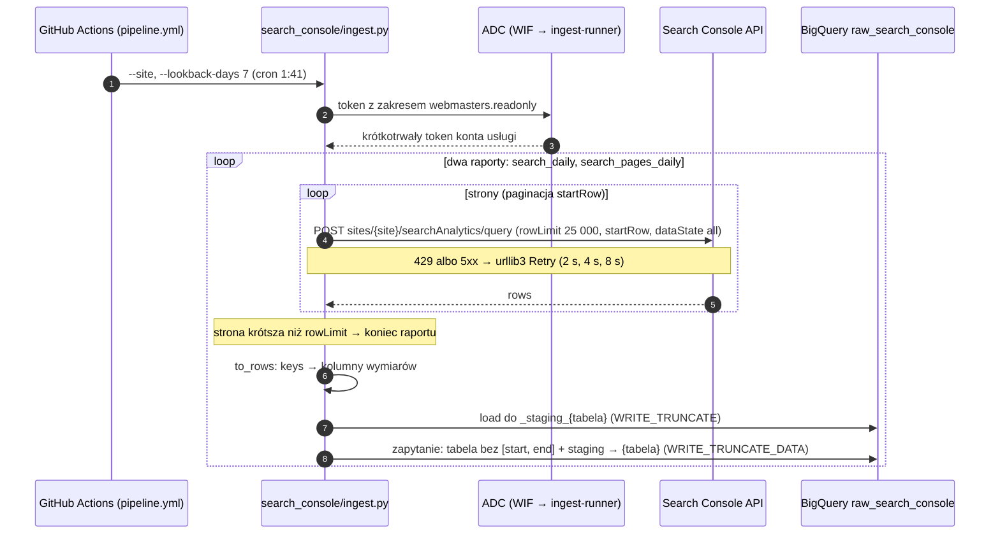

# Diagram sekwencji UML: jedno uruchomienie ingestu Search Console

Kto wywołuje kogo w jednym przebiegu `search_console/ingest.py`. Wspólny zapis do BigQuery (staging → podmiana zakresu): [README główne](../README.md).

| Krok | Po co |
|---|---|
| 2–3 | bez klucza JSON: lokalnie impersonacja, w Actions Workload Identity Federation |
| 4–5 | API nie podaje liczby wierszy — koniec poznajemy po krótszej stronie |
| 4 | `dataState: all` bierze też wstępne dane z ostatnich dni; poprawi je kolejny lookback |
| 7–8 | podmiana zakresu jednym zapytaniem: powtórne uruchomienie nie dubluje wierszy |
