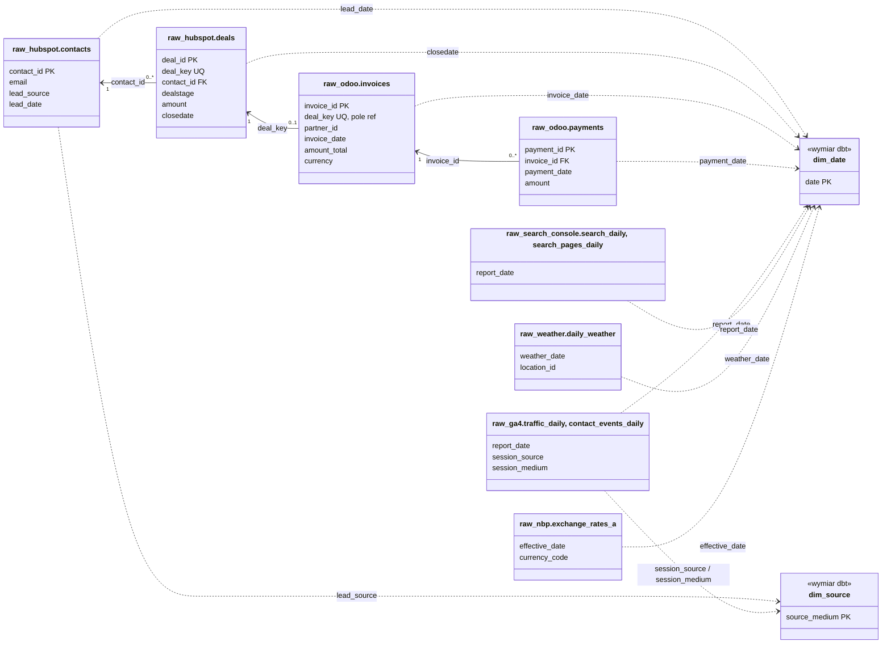
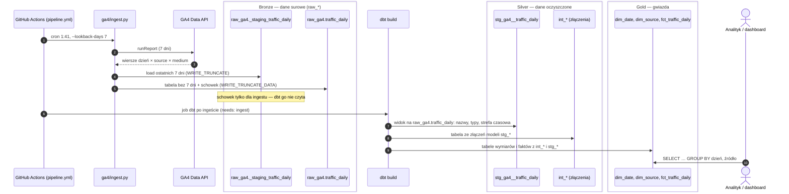

# Diagram klas UML: model danych i klucze łączące źródła

Tabele `raw_*` i klucze, którymi się łączą. CRM i ERP łączą się kluczami rekordów (krotności 1:N i 1:1), a GA4, Search Console, pogoda i NBP z resztą — tylko wspólnymi wymiarami `dim_date` i `dim_source` (modele dbt). Objaśnienia: [README główne](README.md#klucze-łączące-źródła).

| Linia | Znaczenie |
|---|---|
| ciągła, z krotnością | klucz rekordu: łączy konkretne wiersze |
| przerywana | wspólny wymiar: łączy agregaty `data × źródło`, bez użytkowników |

# Diagram sekwencji UML: od API do raportu (bronze → silver → gold)

Kolejność w jednym nocnym przebiegu na przykładzie ruchu z GA4. Kroki 1–5 działają (`ga4/ingest.py`); kroki 6–11 to etap 7 (dbt), w budowie.

| Krok | Po co |
|---|---|
| 4–5 | bronze: kopia źródła 1:1, cała historia; schowek `_staging_*` służy tylko do podmiany zakresu |
| 8 | silver: jeden model `stg_*` na jedną tabelę `raw_*`, bez złączeń i agregacji |
| 9 | silver: złączenia między źródłami, np. faktura → deal → kontakt |
| 10 | gold: gwiazda Kimballa — wymiary wspólne dla wszystkich faktów |
| 11 | raporty czytają tylko gold, nigdy `raw_*` |

Kiedy powstaje dziura: `--lookback-days 7` pobiera ostatnie 7 dni od dziś, więc przerwa w harmonogramie dłuższa niż 7 dni zostawia w `raw_*` dni bez danych — trzeba wtedy uruchomić ingest ręcznie z `--start`. dbt tej dziury nie załata: modele czytają tylko to, co jest w `raw_*`.
