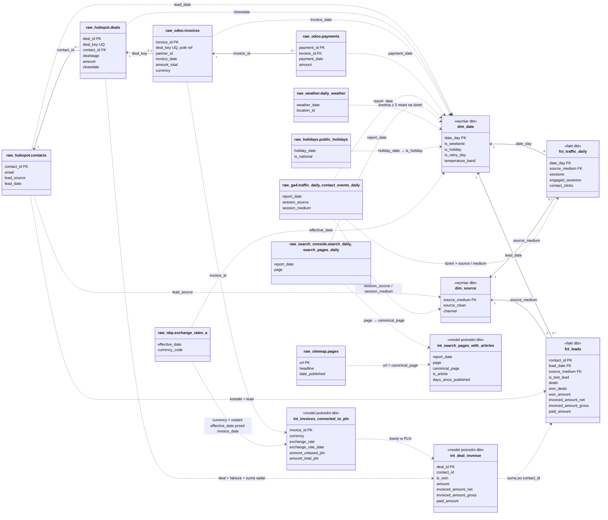
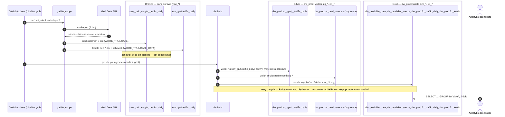
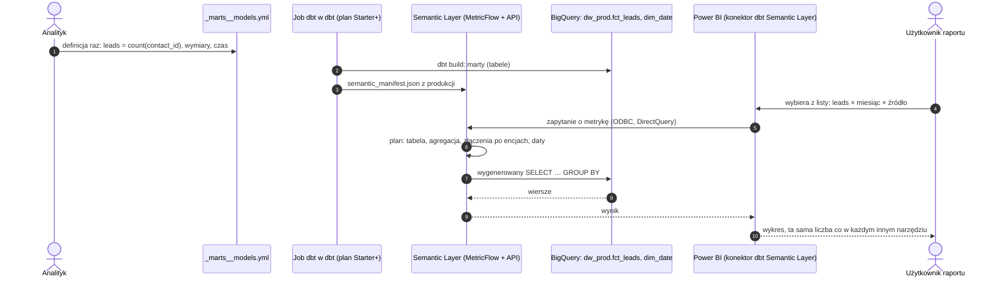
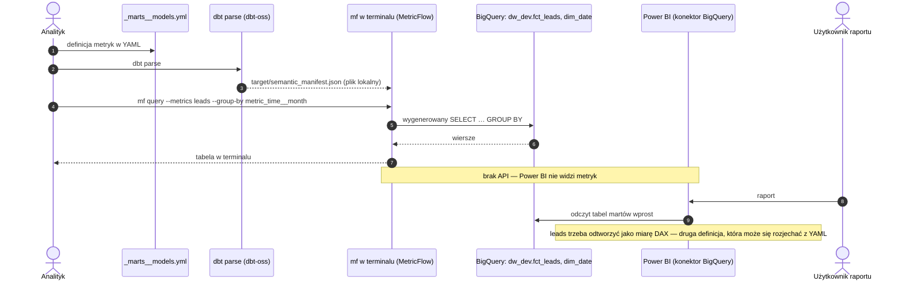
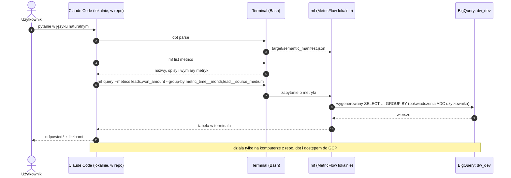
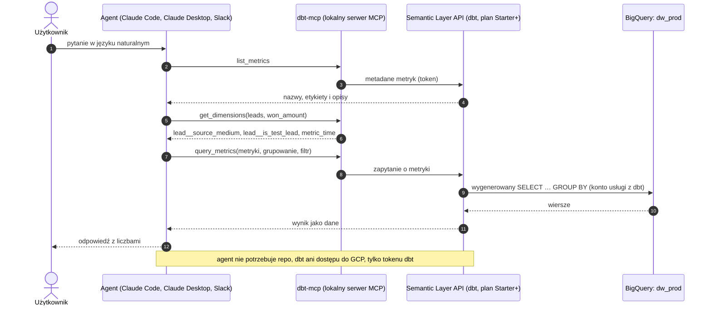

# Diagram klas UML: model danych i klucze łączące źródła

Tabele `raw_*`, modele dbt w warstwie gold i klucze, którymi się łączą. CRM i ERP łączą się kluczami rekordów (krotności 1:N i 1:1), NBP z fakturami — walutą i datą (kurs z ostatniego dnia notowań przed fakturą), Search Console z sitemapą — adresem strony, a GA4, Search Console, pogoda i święta z resztą — tylko wspólnymi wymiarami `dim_date` i `dim_source` (modele dbt). Objaśnienia: [niżej](#klucze-łączące-źródła).

| Linia | Znaczenie |
|---|---|
| ciągła, z krotnością | klucz rekordu: łączy konkretne wiersze |
| przerywana | wspólny wymiar: łączy agregaty `data × źródło`, bez użytkowników |

## Klucze łączące źródła

GA4 Data API zwraca agregaty, nie użytkowników, a pmdata.pl nie ma formularza — tylko kliknięcia w e-mail, telefon i LinkedIn. Syntetyczne leady dostają źródło według proporcji źródeł z GA4 w kliknięciach w kontakt, a ich liczba to kliknięcia × założony współczynnik. Dlatego CRM i ERP łączą się kluczami rekordów, a GA4 z resztą — tylko wspólnymi wymiarami `data × źródło`.

- Klucze rekordów: `contact_id`, `deal_key` (unikalna właściwość w HubSpot, w Odoo pole `ref` faktury) i `invoice_id`.
- Źródło faktury wynika z łańcucha faktura → deal → kontakt; ruch dochodzi dopiero do sumy `data leada × źródło`, nie do pojedynczej faktury.
- Search Console nie ma wymiaru źródła — w całości to `google / organic`. Z sitemapą łączy się adresem strony po normalizacji do postaci kanonicznej (`https` bez `www`, `/blog/` → `/artykuly/`, końcowy `/`), bo Google raportuje też warianty sprzed przekierowań 301.
- Pogoda i święta łączą się tylko datą; święta są ogólnopolskie, więc nie potrzebują wymiaru regionu. NBP łączy się z fakturą walutą i datą: kurs z ostatniego dnia notowań przed `invoice_date` (art. 31a ustawy o VAT), bo NBP nie publikuje kursów w weekendy i święta; tabela A nie zawiera PLN, więc PLN ma kurs 1.
- `invoices.partner_id` to klient w Odoo bez e-maila — z kontaktem łączy go `deal_key`, nie partner.

# Diagram sekwencji UML: od API do raportu (bronze → silver → gold)

Kolejność w jednym nocnym przebiegu na przykładzie ruchu z GA4. Kroki 1–5 to ingest (`ga4/ingest.py`), kroki 6–10 — etap 7 (dbt).

| Krok | Po co |
|---|---|
| 4–5 | bronze: kopia źródła 1:1, cała historia; schowek `_staging_*` służy tylko do podmiany zakresu |
| 7 | silver: jeden model `stg_*` na jedną tabelę `raw_*`, bez złączeń i agregacji; wszystkie modele dbt w jednym datasecie `dw_prod` (lokalnie `dw_dev`), warstwę wskazuje prefiks |
| 8 | silver: złączenia między źródłami, np. faktura → deal → kontakt |
| 9 | gold: gwiazda Kimballa — wymiary wspólne dla wszystkich faktów |
| 10 | raporty czytają tylko gold, nigdy `raw_*` |

Kiedy powstaje dziura: `--lookback-days 7` pobiera ostatnie 7 dni od dziś, więc przerwa w harmonogramie dłuższa niż 7 dni zostawia w `raw_*` dni bez danych — trzeba wtedy uruchomić ingest ręcznie z `--start`. dbt tej dziury nie załata: modele czytają tylko to, co jest w `raw_*`.

# Diagram sekwencji UML: model semantyczny dbt (metryki → SQL → raport)

Model semantyczny (`semantic_model` i `metrics` w `model/models/marts/_marts__models.yml`) to słownik nad martami: tabele zostają, a MetricFlow z pytania „metryka × wymiar” generuje SQL regułami, bez AI — to samo pytanie daje zawsze ten sam SQL. Dwa warianty: z planem płatnym dbt (Starter i wyżej) i bez niego — tak działa ten projekt.

## Z planem płatnym: Semantic Layer w dbt i Power BI

## Bez planu płatnego: ten projekt (dbt-oss + `mf` lokalnie)

| # | Z planem płatnym | Bez planu płatnego |
|:-:|---|---|
| 1 | Analityk dopisuje metryki (`leads`, `won_amount` itd.) do `_marts__models.yml`. To jedyne miejsce, gdzie metryka jest zdefiniowana. | Jak krok 1 z planem płatnym. |
| 2 | Job w dbt uruchamia `dbt build` i buduje marty w `dw_prod`. To te same tabele co bez planu płatnego. | Analityk uruchamia `dbt parse`. dbt czyta YAML i sprawdza składnię, ale nie łączy się z BigQuery i niczego nie buduje. |
| 3 | Ten sam job przekazuje `semantic_manifest.json` z produkcji do serwisu Semantic Layer. Od teraz serwis zna aktualne definicje metryk, bez ręcznego `dbt parse`. | `dbt parse` zapisuje definicje do `target/semantic_manifest.json`. `mf` czyta tylko ten plik, więc bez ponownego `dbt parse` nie widzi zmian w YAML. |
| 4 | Użytkownik raportu wybiera w Power BI metrykę i wymiary z listy. Nie pisze DAX ani SQL. | Analityk wpisuje w terminalu `mf query` z nazwą metryki i wymiaru. Podaje tylko nazwy, bez SQL. |
| 5 | Power BI wysyła pytanie o metrykę przez konektor dbt (ODBC, tryb DirectQuery). Każde kliknięcie w raporcie to nowe zapytanie. | MetricFlow składa z manifestu `SELECT … GROUP BY` według reguł, bez AI, i wysyła go do `dw_dev`. To samo `mf query` zawsze daje ten sam SQL. |
| 6 | MetricFlow planuje zapytanie: którą tabelę czytać, jak agregować, co złączyć po encjach i do jakiej daty przyciąć. Plan powstaje według reguł, bez AI. | Jak krok 8 z planem płatnym, tylko w `dw_dev`. |
| 7 | Serwis wysyła wygenerowany `SELECT … GROUP BY` do BigQuery. Zapytanie jest takie, jakie napisałby analityk, tylko składa je maszyna. | `mf` wyświetla wynik jako tabelę w terminalu. Tu kończy się to, co daje warstwa semantyczna bez planu płatnego. |
| 8 | BigQuery wykonuje zapytanie na martach i zwraca wiersze. Kosztuje tyle samo co zapytanie pisane ręcznie. | Użytkownik otwiera raport w Power BI. Power BI nie widzi metryk, bo bez planu płatnego nie ma API Semantic Layer. |
| 9 | Serwis Semantic Layer oddaje wynik do Power BI. Power BI nie liczy niczego sam, tylko wyświetla. | Power BI czyta tabele martów wprost przez konektor BigQuery. Metrykę `leads` trzeba odtworzyć jako miarę DAX: to druga definicja, która może się rozjechać z YAML. |
| 10 | Użytkownik widzi wykres. Ta sama metryka w Tableau, Google Sheets czy przez API da tę samą liczbę, bo pochodzi z jednej definicji. | — |

| | Z planem płatnym | Bez planu (ten projekt) |
|---|---|---|
| Gdzie powstaje SQL metryki | serwis Semantic Layer w dbt | `mf` na komputerze analityka |
| Kto korzysta z metryk | każde narzędzie z konektorem (Power BI, Tableau, Google Sheets, API) | tylko terminal |
| Power BI | lista metryk i wymiarów, DirectQuery przez konektor dbt | tabele martów, miary w DAX |
| Co daje model semantyczny | jedna definicja dla wszystkich narzędzi | walidacja definicji i szybkie zapytania analityka |

Marty zostają w obu wariantach: ich SQL czyści i łączy źródła w tabele, a MetricFlow generuje tylko zapytanie agregujące na gotowych tabelach. Konektor Power BI wymaga planu Starter lub wyższego, Power BI Desktop (Windows) i trybu DirectQuery; w Power BI Service — bramy On-premises Data Gateway ([dokumentacja](https://docs.getdbt.com/docs/platform-integrations/semantic-layer/power-bi)).

# Diagram sekwencji UML: agent AI pyta o metryki

Pytanie przykładowe: „ile leadów i jaka kwota wygranych deali z organic w październiku?”. Agent w obu wariantach nie pisze SQL — wybiera nazwy metryk i wymiarów, a SQL składa MetricFlow.

## Bez planu płatnego: Claude Code i terminal (działa w tym repo)

## Z planem płatnym: dowolny agent przez `dbt-mcp` i Semantic Layer API

| # | Bez planu płatnego | Z planem płatnym |
|:-:|---|---|
| 1 | Użytkownik zadaje pytanie w Claude Code uruchomionym w folderze repo. Agent ma dostęp do terminala i plików projektu. | Użytkownik pyta agenta, np. w Claude Desktop albo w Slacku. Nie musi mieć repo ani terminala. |
| 2 | Agent uruchamia `dbt parse`, żeby manifest odpowiadał aktualnemu YAML. Bez tego `mf` widziałby stare definicje. | Agent woła narzędzie MCP `list_metrics`. Serwer `dbt-mcp` działa lokalnie i ma token dbt w zmiennych środowiskowych. |
| 3 | `dbt parse` zapisuje `target/semantic_manifest.json`. To jedyne źródło definicji dla `mf`. | `dbt-mcp` pyta API Semantic Layer o metadane z tokenem. Zapytania o metadane nie liczą się do limitu metryk. |
| 4 | Agent uruchamia `mf list metrics`. To odpowiednik narzędzia `list_metrics` z MCP, tylko przez Bash. | Agent dostaje nazwy, etykiety i opisy metryk z produkcji. Definicje pochodzą z ostatniego udanego joba, a nie z lokalnego YAML. |
| 5 | Agent dostaje nazwy, opisy i wymiary metryk. Po opisach wybiera `leads` i `won_amount`. | Agent woła `get_dimensions` dla wybranych metryk. Dowiaduje się, po czym może grupować i filtrować. |
| 6 | Agent wpisuje `mf query` z metrykami, wymiarami i filtrem. Podaje nazwy, nie SQL. | Agent dostaje listę wymiarów. To te same nazwy co w `mf list metrics`. |
| 7 | Terminal uruchamia MetricFlow na tym samym komputerze. Żaden serwis dbt nie bierze udziału. | Agent woła `query_metrics` z metrykami, grupowaniem i filtrem. Dalej podaje nazwy, nie SQL. |
| 8 | MetricFlow składa SQL i wysyła go do `dw_dev` z poświadczeniami ADC użytkownika. Dostęp do danych jest taki jak jego konta. | `dbt-mcp` przekazuje zapytanie do API. Każda metryka w zapytaniu liczy się do limitu 5 000 miesięcznie w planie Starter. |
| 9 | BigQuery zwraca wiersze. Koszt jak przy zapytaniu pisanym ręcznie. | Serwis dbt generuje SQL w MetricFlow i wykonuje go w `dw_prod` kontem usługi z połączenia dbt. Dostęp do danych zależy od uprawnień tokenu, nie użytkownika. |
| 10 | `mf` wypisuje tabelę, którą agent czyta z wyjścia terminala. Długie wyniki trzeba ograniczać (`--limit`). | Jak krok 9 bez planu płatnego, tylko w `dw_prod`. |
| 11 | Agent odpowiada liczbami. Może dopytać, powtarzając kroki 6–10. | Agent dostaje wynik jako dane strukturalne, nie tekst z terminala. |
| 12 | — | Agent odpowiada liczbami. Te same metryki widzą w tym czasie Power BI, arkusze i API. |
