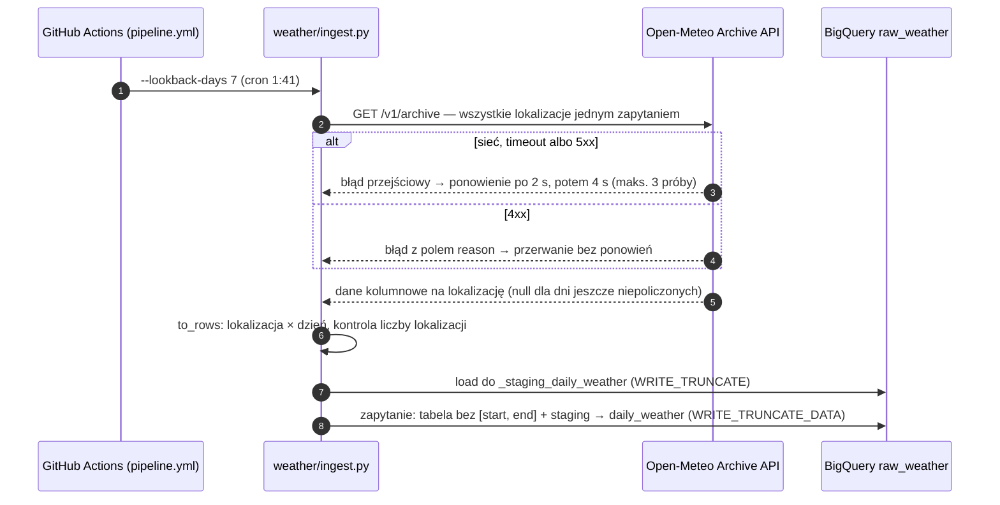

# Diagram sekwencji UML: jedno uruchomienie ingestu pogody

Kto wywołuje kogo w jednym przebiegu `weather/ingest.py`. Wspólny zapis do BigQuery (staging → podmiana zakresu): [README główne](../README.md).

| Krok | Po co |
|---|---|
| 1 | ostatnie dni są wstępne, więc tydzień wstecz jest przeliczany przy każdym uruchomieniu |
| 2 | pięć miast jednym GET-em zamiast pięciu |
| 3–4 | ponawiamy tylko to, co może się udać za chwilę |
| 7–8 | podmiana zakresu jednym zapytaniem: powtórne uruchomienie nie dubluje wierszy |
